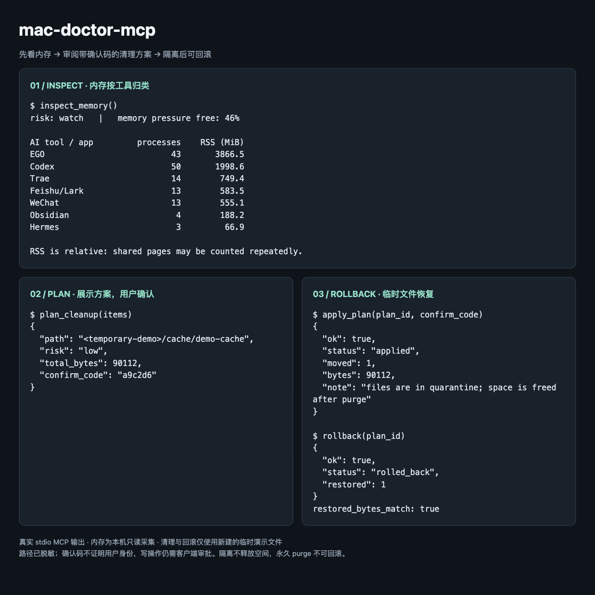

# mac-doctor-mcp

让 AI 查看 Mac 的内存、存储和硬件状态，再由人决定是否清理。Python 3.12+，通过本地 stdio 提供 MCP 工具。无需常驻监控，也不会自动清理或结束进程。



图中内存来自本机只读采集；清理与回滚来自临时演示文件，路径已脱敏。

## 能做什么

- **内存**：读取 `memory_pressure -Q`、`vm_stat`、`sysctl vm.swapusage`，显示物理内存、swap、风险等级，以及按 Claude Code、Codex、EGO、Hermes、Cursor 等应用归类的进程。检测 cwd 位于已删除 `.worktrees/<name>` 的进程，只提示，不杀进程。
- **存储**：显示指定目录下最大的直接子项和卷剩余空间。安装了 [Mole](https://github.com/tw93/Mole) 且支持 JSON 分析时，额外调用 `mo analyze --json <root>` 返回候选，保留 `scan_status`。不完整扫描的大小只是下界；候选不等于可以删除。
- **硬件（可选）**：安装了 [siltop](https://github.com/CLoaKY233/siltop) 时，读取 `siltop report today --json` 和 `siltop --json` 单次实时快照。未安装或命令失败会返回 `available: false` 和原因；部分成功的数据仍保留。不会安装 agent、启动服务或运行压力测试。
- **已有事务工具**：生成清理计划、移入隔离区、回滚、中断恢复及到期清空。v0.1 在 Mac 上验证只读采集；事务测试仅在临时目录运行，真实文件清理尚未验收。

Linux 采集器仅供开发和测试，内存读取 `/proc/meminfo`，硬件显示不支持；本项目面向 macOS。

### 怎样理解内存

输出包含 `total_bytes`、`available_bytes`、`swap_used_bytes`、`free_percent`、`risk`。Mac 的 `available_bytes` 是 `vm_stat` 的 free pages × page size，**不包含可回收缓存**；`free_percent` 来自 macOS 的 memory pressure 指标，不能用前两个字段相除代替。Linux 的 available 则来自 `MemAvailable`，两平台口径不同。

Mac 风险阈值：free percent < 10，或 < 20 且 swap ≥ 4 GiB，标为 `pressure`；否则 free percent < 25、swap ≥ 1 GiB 或压缩内存 ≥ 物理内存 30% 时标为 `watch`；其余为 `healthy`。swap 可能来自历史压力，单次高 swap 不等于当前正在吃紧。进程 RSS 和分组 RSS 只适合相对比较，共享页会重复计数。

## 本地运行

安装 [uv](https://docs.astral.sh/uv/) 后直接启动（uv 可按需准备 Python 3.12+）：

```bash
uvx --from git+https://github.com/bmdy6/mac-doctor-mcp mac-doctor-mcp
```

服务使用标准输入输出，启动后等待 MCP 客户端连接。可选工具从服务的 `PATH` 查找；没有 siltop 或 Mole 也能使用内存与存储采集。GUI 客户端若找不到 `uv`，请把配置中的 command 换成 `uv` 可执行文件的绝对路径。

## MCP 配置

无需克隆仓库。以下配置直接从 GitHub 安装运行。

### Claude Code

在客户端的 `.mcp.json` 中配置：

```json
{
  "mcpServers": {
    "mac-doctor": {
      "type": "stdio",
      "command": "uvx",
      "args": ["--from", "git+https://github.com/bmdy6/mac-doctor-mcp", "mac-doctor-mcp"]
    }
  }
}
```

也可使用 CLI 注册：

```bash
claude mcp add --transport stdio mac-doctor -- uvx --from git+https://github.com/bmdy6/mac-doctor-mcp mac-doctor-mcp
```

### Codex

在 `~/.codex/config.toml` 配置。建议先只启用三个 inspect 工具：

```toml
[mcp_servers.mac-doctor]
command = "uvx"
args = ["--from", "git+https://github.com/bmdy6/mac-doctor-mcp", "mac-doctor-mcp"]
enabled_tools = ["inspect_memory", "inspect_storage", "inspect_hardware"]
tool_timeout_sec = 180
```

配置格式参见 [Claude Code 官方文档](https://code.claude.com/docs/en/mcp)与 [Codex 官方 MCP 文档](https://developers.openai.com/codex/mcp/)。这些是配置示例，不会替你修改客户端配置。

## 工具列表

| 工具 | 参数 | 作用及写入范围 |
| --- | --- | --- |
| `inspect_memory` | `top=10`（1–50） | 只读内存、进程和 worktree 残留检测 |
| `inspect_storage` | `roots=null`, `top=15`（1–100） | 只读统计与可选 Mole 分析；默认扫描存在的清理白名单与项目根 |
| `inspect_hardware` | 无 | siltop 当日报告与单次快照 |
| `plan_cleanup` | `items=[{path, reason, risk}]` | 不移动目标文件，但保存计划及确认码到本地状态目录 |
| `apply_plan` | `plan_id`, `confirm_code` | 将计划内目标移入同卷隔离区，可回滚 |
| `rollback` | `plan_id` | 将隔离区文件恢复到原位置 |
| `recover` | 无 | 对中断的 apply/rollback 执行恢复，会移动文件 |
| `list_quarantine` | 无 | 列出批次状态与大小 |
| `purge_quarantine` | `keep_days=7`, `confirm_code=null` | 不带码仅预览；带确认码永久删除到期批次，不可回滚 |

存储扫描可能较慢，建议先指定较小的目录，例如 `{"roots":["/path/to/cache"],"top":5}`。无权限、符号链接及含禁区内容的项目可能显示为 skipped。Mole 不支持 `analyze --json` 时跳过，不回退到交互界面或清理命令；Mole 的 HOME、缓存和临时目录隔离在一次性临时目录，避免影响其真实状态。

## 安全规则

1. **先计划再确认**：AI 必须展示每项路径、原因、风险、总大小和确认码；用户亲自回传确认码后才能调用 `apply_plan`。确认码只校验匹配，服务器不能证明是谁输入的，仍需客户端审批约束。
2. **白名单与禁区**：默认允许缓存、日志、Downloads 等根目录下的项目；项目根目录下只允许已知构建产物目录（如 `node_modules`、`.next`、`DerivedData`）。禁区优先，包含 `.git`、密钥目录、钥匙串、知识库、Hermes、Codex、Agent 技能与记忆目录等，详见 `policy.py`。自定义白名单也不能覆盖禁区。
3. **隔离不等于释放空间**：apply 使用同卷 rename，不复制；真正释放空间需要到期 purge。跨卷目标拒绝执行，回滚遇到原位置冲突不会覆盖。
4. **中断恢复**：journal 未恢复时拒绝新的执行，使用 `recover` 恢复；有审计日志。计划有有效期，执行时重新验证文件身份。现有核心不承诺逐文件内容 SHA 校验。
5. **永久清空单独确认**：`purge_quarantine` 默认保留 7 天，最少 1 天；先调用无确认码预览，用户确认后才传码清空。
6. **本地权限边界**：以当前用户权限运行，不使用 sudo。内存输出不包含完整 argv 或环境变量；存储和第三方硬件 JSON 可能含路径、用户名或应用信息，分享前先脱敏。

默认状态目录为 `~/.mac-doctor`，可通过 `MAC_DOCTOR_HOME` 修改；配置文件为 `~/.config/mac-doctor/config.json`，可通过 `MAC_DOCTOR_CONFIG` 修改。存储工具加载事务对象时会初始化状态目录，但不会修改扫描目标。

配置文件可按需设置以下字段（不配置则使用默认值）：

```json
{
  "allow_roots": ["~/Library/Caches", "~/.cache"],
  "artifact_roots": ["~/Projects"]
}
```

## 与 Mole 的关系

这是独立的 MCP 服务，不是 Mole 官方项目。Mole 是可选的只读分析来源：只调用 `mo analyze --help` 检查能力，再调用 `mo analyze --json <root>`，从不调用 `clean`。清理方案、确认码、隔离和回滚由本项目实现。

工具注解是客户端提示，不是权限控制；`plan_cleanup` 的 readOnlyHint 指目标文件不变，仍会保存本地计划。确认码不证明用户身份，客户端必须审批写操作，不能让模型自行生成并回传确认码来代替用户同意。

## 开发与验收

```bash
uv run pytest -q
uv build --wheel
uv run python scripts/inspect_smoke.py --root ./src
```

测试用固定文本覆盖 Mac 解析与风险阈值，用 mock 覆盖可选工具缺失、失败及只读命令边界；事务测试只操作 pytest 临时目录。smoke 脚本通过真实 stdio MCP 连接，列出工具并只调用三个 inspect，将存储路径、worktree 名和硬件身份字段脱敏后输出摘要；服务状态隔离在临时目录。Mole 未安装时，smoke 只能验证跳过分支。
