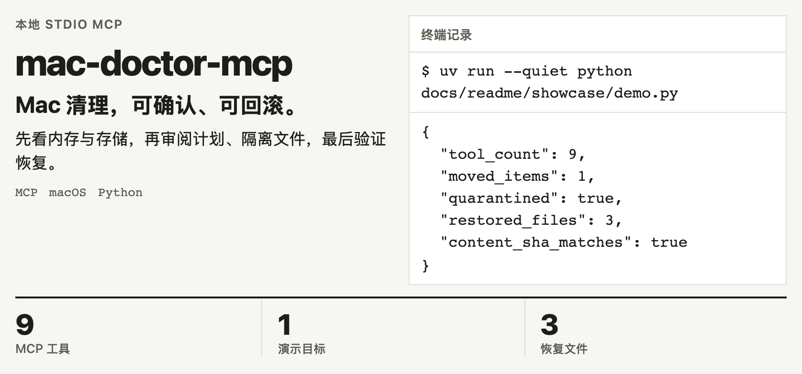
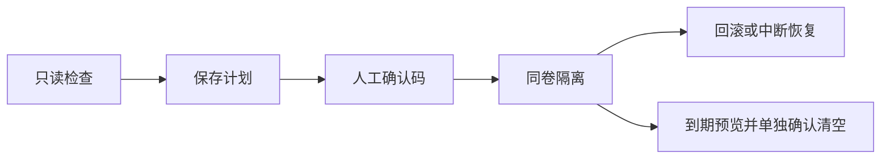

<!-- readme-from-code:banner:hero:start -->
<h1><picture>
  <source media="(prefers-color-scheme: dark)" srcset="docs/readme/hero-dark.zh-CN.png">
  
</picture></h1>
<p><em>2026-11-11，临时合成文件上的真实 stdio MCP 运行；未清理用户文件。 <code>uv run --quiet python docs/readme/showcase/demo.py</code></em></p>
<!-- readme-from-code:banner:hero:end -->

[快速开始](#快速开始) · [能力](#能力) · [工作流程](#工作流程) · [完整参考](docs/REFERENCE.md)

```sh
uvx --from git+https://github.com/bmdy6/mac-doctor-mcp mac-doctor-mcp
```

面向使用 AI agent 的 Mac 开发者：知道内存和磁盘发生了什么，把“删掉试试”换成能检查、能撤回的文件事务。

## 为什么用它

| 手动处理 | 用 mac-doctor-mcp |
| --- | --- |
| 在多个系统命令间拼凑状态 | 从 MCP 读取内存、存储与可选硬件信息 |
| 直接删除后才发现删错 | 先保存计划，再用确认码移入同卷隔离区 |
| 出错后手动找回文件 | rollback 恢复原位置；recover 处理被中断的移动 |

## 能力

| 看清现状 | 保留退路 |
| --- | --- |
| **内存压力与进程分组**：读取 pressure、swap，按应用归类进程。 | **先计划再执行**：保存逐项目标、风险、大小与确认码。 |
| **存储候选**：扫描直接子项；Mole 可作为可选分析源。 | **同卷隔离与回滚**：移动文件，遇到原位置冲突拒绝覆盖。 |
| **可选硬件快照**：读取 siltop；未安装时返回原因。 | **中断恢复**：journal 记录移动状态，恢复后再继续。 |

## 看它运行

横幅来自附带的[可重放演示](docs/readme/showcase/demo.py)：MCP 实际返回 **9 个工具**；创建 **1 个目录、3 个文件**，执行计划、隔离与回滚，恢复后的内容 SHA 与原始内容一致。
这些是这次合成样例的结果，不是清理性能或真实磁盘释放量。

## 快速开始

需要 macOS、Python 3.12+ 和 [uv](https://docs.astral.sh/uv/)。首次安装需要网络。


这是等待客户端连接的 stdio 服务。把命令加入 MCP 客户端后，先问：“读取内存压力，解释 swap 与进程分组，先不要清理。”
[Claude Code、Codex 配置和完整工具参数](docs/REFERENCE.md#mcp-配置)可直接查阅。

## 工作流程



路径策略先检查白名单、禁区和符号链接。apply 重新验证目标身份，用同卷 rename 移动文件；journal 与审计记录保留操作轨迹。

## 可信度

- 本次 `uv run pytest -q`：**55 passed，1 skipped**；跳过的是仅供 Linux 的采集用例。
- 以当前用户权限运行，不使用 sudo；只读检查不会结束进程。
- 清理计划也会写本地元数据；readOnlyHint 不是操作系统权限控制。

## 常见问题与限制

**隔离就释放磁盘空间吗？** 不会。同卷移动仍占用空间；只有到期 purge 真正删除，且不可回滚，须另行确认。

**确认码能证明是人批准的吗？** 不能。客户端仍须审批写操作，不能让模型自动回传计划里的码。

**必须安装 Mole 或 siltop 吗？** 不必。它们是可选的只读数据源；缺失或失败会报告状态，不会自动安装。

**支持 Linux 吗？** Linux 采集器服务于开发测试，产品面向 macOS。[内存指标口径、安全规则与完整开发命令](docs/REFERENCE.md)保留在参考页。

## 参与贡献

先提 Issue；开发时运行 `uv run pytest -q`。图源和复现方式见 [SOURCES](docs/readme/SOURCES.md)。
[English banner](docs/readme/hero-light.png) · [Dark English banner](docs/readme/hero-dark.png)

## 许可证

[MIT](LICENSE)。如果这套确认与回滚流程对你有用，欢迎点 Star。
